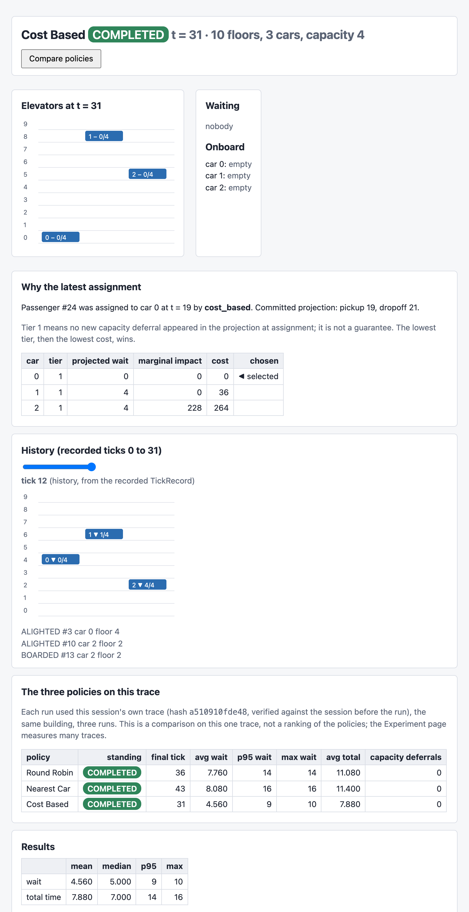
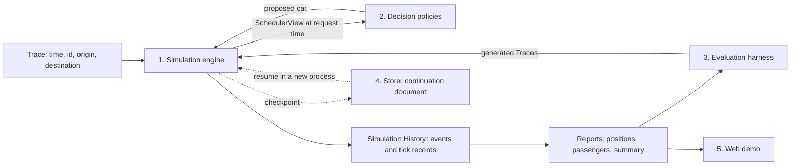

# Elevator Dispatch Simulation

This project simulates a bank of elevators serving passengers who give their origin and destination when they request a ride. The dispatcher assigns each passenger to one car at request time and never changes the assignment.

I compare one proposed scheduler against two baselines. Round Robin provides a simple state-blind benchmark. Nearest Car represents the obvious state-aware heuristic. The Cost Based policy goes further by projecting each car's committed route before choosing an assignment.



*Web demo showing the recorded elevator state, passenger outcomes, and cost-based decision evidence.*

The core solution is the simulator and the dispatch policies. The evaluation and continuation layers show how I would validate and operate the same decision system beyond the exercise.

## 1. Problem

The dispatcher has to pick a car for every request using only what is known when the request arrives. Time advances in whole ticks, and a car moves at most one floor per tick. A request carries a time, a passenger id, an origin floor and a destination floor. The dispatcher assigns it to a car immediately and has no information about requests that have not arrived yet.

Each car has a capacity and a direction of travel. A car can pass a waiting passenger because it is full or heading the other way, and that passenger waits for it to come back. Every passenger must be served eventually. The objective is low wait and low total time, where total time is wait plus travel.

A run writes a position log with one row per tick, the minimum, maximum and average wait and total time, and a short list of observations. Identical inputs produce identical files.

## 2. Simulation semantics

The brief leaves several rules open. I fixed the ones that change results before writing any policy.

- Each tick runs nine steps in a fixed order. The engine reveals requests, assigns them, lets passengers alight, lets passengers board, sets each car's heading, records the tick, tests for completion, moves the cars and advances the clock.
- The position log records each car at the start of the tick, before it moves.
- A passenger boards only a car that will leave that floor in the passenger's direction. A car that is idle or at the end of its sweep takes the waiting passenger with the lowest id who fits and travels in that passenger's direction.
- A car reverses in the same tick it finishes a sweep. Stops take no time.
- An assignment is final.
- Ties go to the lowest car id. Nothing in a run uses randomness.

[docs/design.md](docs/design.md) walks through these rules with worked examples.

## 3. Architecture

The engine owns the cars and passengers and is the only component that changes them. A policy receives a SchedulerView, a read-only view of committed state plus the new request, and returns a car number. The engine checks the number, writes the assignment and records the policy's reasoning in the Simulation History.



The five parts are the simulation engine, the policies, the evaluation harness, the Store used for continuation, and the web demo. The harness generates Traces and runs the engine like any other caller. A policy never sees a generated scenario, only the SchedulerView at request time.

## 4. Scheduling policies

The three policies differ in how much of the car state they use. Round Robin uses none of it, Nearest Car uses car positions, and Cost Based uses the full committed route of every car.

Round Robin assigns passenger `p` to car `p mod N`, where `N` is the number of cars.

Nearest Car assigns the car whose floor is closest to the passenger's origin and breaks ties by lowest id. It ignores load and direction.

For each car, Cost Based projects the committed route twice, once without the new passenger and once with them. The projection calls the same movement functions as the engine, so it is exact for the current committed state. Later assignments can change the route, which is what the calibration section measures. The score combines the candidate's projected wait, a penalty on waits longer than one full sweep, and the signed change in dropoff times for passengers already assigned to that car. Each of those dropoff changes is weighted by how long that passenger has already waited.

```text
cost = age_scale * (w_wait * wait + w_tail * max(0, wait - tail_threshold)) + w_marginal * marginal
```

The defaults are `w_wait = 1`, `w_tail = 3`, `w_marginal = 1`, `tail_threshold = 2 * (F - 1)` and `age_scale = F - 1`, where `F` is the number of floors.

The policy first keeps the cars where the assignment creates no new capacity deferral. A capacity deferral is a passenger who has to wait for a later pass because the car is full. Among those cars it takes the lowest cost and breaks ties by lowest car id. If every car would create a deferral, it picks the lowest cost among all cars, since every passenger needs a car.

The marginal term can be negative. In one tested case a new passenger's stop makes a car continue instead of turning. One existing passenger is delivered 10 ticks earlier and another 4 ticks later. Each is weighted at 11 per tick, so the marginal term is -110 + 44 = -66. The new passenger's wait is 2 and the cost is -52.

Each assignment stores a receipt with every candidate's tier, wait, marginal term and cost. The web demo displays the stored receipt and never recomputes it.

### Why there is no demand forecast

The scheduler does not forecast future demand. At assignment time it sees only the current car state and the passengers already committed.

This follows the logic of Applied Information Economics. Before adding a forecasting model, I first measure the uncertainty that matters to the decision. Here that uncertainty is the difference between the route projected at assignment time and what later happens after new requests arrive. Section 7 measures it. If that error is small or rarely changes the preferred assignment, forecasting has little value. If it is large and decision-relevant, forecasting becomes the next experiment, run on the same Traces.

## 5. Evaluation

The evaluation compares the three policies on 180 generated Traces. I evaluate the policies with a paired Monte Carlo experiment. For each demand pattern and seed, the generator creates one Trace and all three policies run on that same Trace, so the comparison is paired rather than made on different random demand.

The fixed Experiment is defined in [experiments/default.json](experiments/default.json). Its parameters were fixed before the committed benchmark evidence was generated.

- The building has 20 floors, 4 cars and capacity 8, and all cars start at floor 0.
- Demand comes in nine patterns with 100 requests each. The patterns are uniform, up peak, down peak, bursty, concentrated origin, concentrated destination, capacity stress, sparse and adversarial.
- Each pattern has 20 seeds, which gives 180 paired seeds.
- Three policies run on each, which gives 540 runs. None halted.

A paired seed is one generated Trace run under all three policies. The comparison between policies is always made on the same Trace.

The generator produces Traces for the evaluation only, and a policy sees each request at its request time.

## 6. Cost Based improves tail wait in most regimes

On this synthetic benchmark, Cost Based has the strongest results against Nearest Car. It has a lower p95 wait than Nearest Car on all 20 seeds in eight of nine demand patterns, and the two policies tie on the sparse pattern. Against Round Robin, Cost Based has a lower p95 wait on all 20 seeds in five patterns and a lower mean total time on all 20 seeds in seven.

The result is not uniform. Under capacity stress, Cost Based and Round Robin are nearly tied on p95 wait. Concentrated origin is another pattern where Round Robin wins some seeds. Nearest Car is competitive on mean wait in some patterns and performs poorly on tail wait and under capacity stress.

The committed evidence is [experiments/default_experiment_results.json](experiments/default_experiment_results.json). The table gives the mean over 20 seeds of each run's 95th percentile wait and mean total time, in ticks. RR is Round Robin, NC is Nearest Car and CB is Cost Based.

| Pattern | p95 wait RR | NC | CB | mean total RR | NC | CB |
| --- | --- | --- | --- | --- | --- | --- |
| uniform | 16.700 | 20.150 | 9.900 | 14.268 | 12.275 | 10.502 |
| up_peak | 19.700 | 30.650 | 16.850 | 18.856 | 20.179 | 16.803 |
| down_peak | 19.250 | 30.450 | 17.950 | 19.172 | 22.240 | 17.129 |
| bursty | 32.350 | 50.900 | 19.100 | 22.547 | 24.721 | 15.363 |
| concentrated_origin | 15.300 | 26.750 | 12.900 | 13.672 | 16.751 | 12.103 |
| concentrated_destination | 15.500 | 20.550 | 12.450 | 13.752 | 13.696 | 11.496 |
| capacity_stress | 74.000 | 380.200 | 73.800 | 47.555 | 209.469 | 47.121 |
| sparse | 15.500 | 9.850 | 9.850 | 13.791 | 10.222 | 10.222 |
| adversarial | 45.000 | 40.000 | 28.000 | 44.340 | 38.000 | 32.100 |

The paired differences, Cost Based minus the baseline on the same Trace, add the following detail. In the sparse pattern Cost Based and Nearest Car produce identical results on all 20 seeds.

- Capacity stress is the closest comparison with Round Robin. The p95 wait is lower on 8 seeds, equal on 8 and higher on 4, with a mean difference of -0.2 ticks. Cost Based has a lower maximum wait on all 20 seeds, by 13.5 ticks on average.
- Concentrated origin is the other pattern where Cost Based loses seeds to Round Robin. Its mean total time is higher on 3 of 20.
- Nearest Car has a lower mean wait than Round Robin on the uniform pattern (5.252 against 7.245) and a higher p95 wait (20.150 against 16.700). I report the tail next to the mean for this reason.
- Under capacity stress Nearest Car averages 92 capacity deferrals per run against 68 for the other two policies, and its mean p95 wait is 380.200 ticks against 73.800 for Cost Based.

The screenshot above uses a separate 25-request example. In that example the final tick is 36 for Round Robin, 43 for Nearest Car and 31 for Cost Based.

## 7. Calibration

In the reporting tests' generated sweep, 947 of 977 cost-based projections matched what happened. The 30 that differed were all on cars that received a later assignment.

Calibration compares what a policy projected at assignment time with what happened. The committed test case has one car with capacity 1 in a 6-floor building, idle at floor 4. Passenger r0 travels from floor 1 to floor 2 and is assigned first. The projection stored with that assignment says r0 boards at tick 6 and arrives at tick 7.

Passenger r1, who travels from floor 0 to floor 5, is then assigned to the same car. The car serves floor 0 first, fills up, rides to floor 5 and comes back for r0. r0 boards at tick 16 and arrives at tick 17, so both errors are +10, where error is realized time minus projected time. The first projection was exact for the state the policy saw. The error comes from a later assignment that changed the route. Passenger r1 had no later assignment to the same car and was served exactly as projected.

In the sweep, 374 of the 977 assignments had no later assignment to the same car, and all 374 matched the projection exactly. The other 603 had a later assignment to the same car, and 30 of those differed from the projection. The web demo shows the same table for any cost-based run.

## 8. Correctness

The suite has 351 tests, and they check the rules that the results depend on.

- The engine and the cost-based policy call the same route functions. A test checks that a projection equals the realized outcome when no later assignment touches that car.
- A no-look-ahead test adds a request after the decision time and checks that every decision and movement before that time is unchanged.
- Every passenger finishes within `T_last + 2 * P * (F - 1)` ticks, where `T_last` is the last request time and `P` is the number of requests. The proof is in the design document and a test enforces the bound.
- The Simulation History is immutable once written. A run that detects a violated rule halts with a named reason.
- Two runs of the same inputs, including runs in separate processes, produce byte-identical output files.
- Edge cases include full cars, wrong-way passes, a car pulled in opposite directions by two passengers, simultaneous requests, requests that skip ahead in time, and empty Traces.


## 9. Restart continuity

A killed run resumes from its checkpoint and finishes with output identical to an uninterrupted run. The checkpoint is one document holding a Snapshot of the state at a tick boundary and the Simulation History so far.

The witness test starts a run, checkpoints at tick 12 and terminates the process with a kill signal. A fresh process resumes from the document. The test checks that the resumed process executes ticks 12 onward without replaying earlier ticks, that its Simulation History and all eight output files match an uninterrupted run byte for byte, that the operational log is one continuous sequence, and that a finished run cannot be reopened. The witness passes for Round Robin and Cost Based.

The evidence covers a Store on a local disk and processes on one machine. The reasoning behind this kind of claim is in [my article on what is still true after a process dies](https://reckoningmachines.substack.com/p/what-is-still-true-after-the-process).

## 10. Web demo

The demo shows one run in detail and compares the three policies on the same Trace.

```text
python -B -m web
```

The demo opens at `http://127.0.0.1:8000`. Choose a policy and a building, then use the built-in 25-request example or paste your own requests. A run can be stepped, played or run to the end. The page shows each car's position with a slider over recorded ticks, passenger outcomes, a wait histogram, a comparison of the three policies on the same Trace, the stored receipt for any assignment, and the calibration table. The Evaluate page shows the fixed Experiment, runs small Experiments and offers the result files for download.

## 11. Running the project

The project needs Python 3.12 or later. From a clean clone, create a virtual environment and install the dependencies.

```text
python3 -m venv .venv
source .venv/bin/activate
pip install pytest httpx fastapi jinja2 uvicorn python-multipart
```

The tests take about three minutes.

```text
python -B -m pytest -q
```

This command runs one simulation on the sample requests, which use the brief's `time,id,source,dest` row format.

```text
python -B -m elevator.cli simulate --requests examples/requests.csv --floors 10 --elevators 3 --capacity 4 --policy cost_based --out runs
```

The output directory `runs/<run_id>/<execution_id>/` contains `elevator_positions.csv`, `summary.json`, `observations.md`, `passengers.csv` and the full Simulation History. The same function is available from Python.

```python
from elevator.api import simulate
result = simulate(rows, num_elevators=3, num_floors=10, capacity=4, policy="cost_based")
```

The fixed Experiment takes about two minutes to run.

```text
python -B -m elevator.cli experiment --config experiments/default.json --out runs
```

The web demo starts with the same command shown in section 10.

Every command uses `python -B`. The simulation refuses to start with bytecode caching enabled, so the code identity recorded in each output names the source files that actually ran. The committed Experiment results were generated at an earlier code identity. Re-running the Experiment on the current code gives the same metric values under the current identity.

## 12. Time spent

Approximately 7 hours, including implementation, testing, evaluation, and documentation.

## 13. Assumptions and tradeoffs

Zero door time and synthetic demand are the two main simplifications.

- Floors are numbered from 0. A request whose origin equals its destination is refused.
- Opening doors and loading take no time. A stop costs nothing beyond the ticks spent travelling.
- The dispatcher reacts to requests as they arrive and does not forecast demand.
- Cost Based is a heuristic with fixed weights.
- The demand patterns are synthetic and were chosen before the evaluation.
- Continuity uses a local Store on one machine, with one document per execution and no database.

## 14. Next steps

1. Use the calibration measurement to test whether a demand forecast has positive value. If later assignments rarely change projections under realistic traffic, a forecast has little to correct.
2. Add door, dwell and acceleration times. They change absolute waits and could change the ranking of policies.
3. Fit the demand patterns to recorded traffic from a real building.
4. Evaluate predictive maintenance inputs only if car availability changes dispatch quality or tail waits.
5. Optimize speed only if a larger building makes the current speed a problem.

## Where to read more

[docs/design.md](docs/design.md) explains the rules and the decision flow with diagrams and worked examples. [docs/walkthrough.md](docs/walkthrough.md) is the presentation outline. [docs/README.md](docs/README.md) indexes the evidence and the development record.

I used Claude Code for implementation, testing, and code review. I made the design decisions and reviewed the resulting code and evidence. The approach I follow is described in [my write-up on agentic coding](https://reckoningmachines.substack.com/p/an-agentic-coding-proposal-constitutional).
