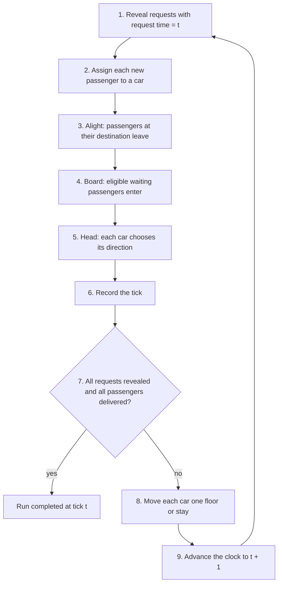
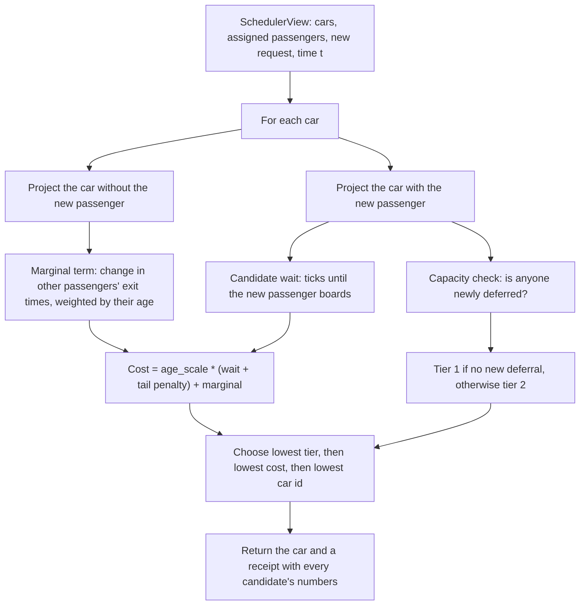
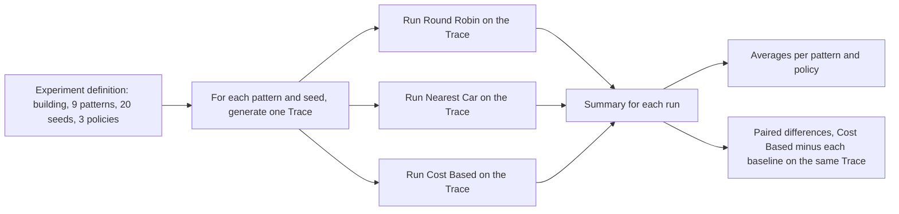
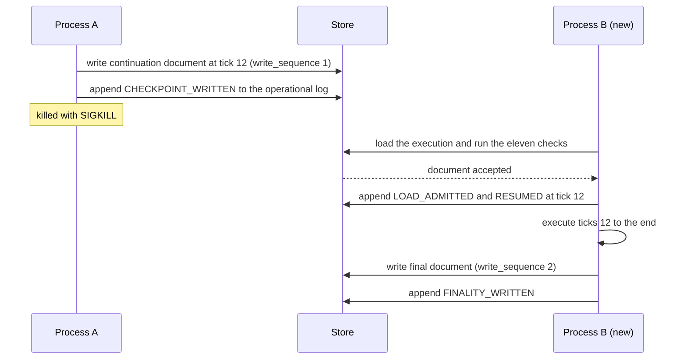

# Design

This document covers how the simulator works and why it is built that way. It goes one level deeper than the [README](../README.md) and takes about ten minutes to read.

## 1. The decision

Each time a request arrives, the system has to pick a car for that passenger using only what is known at that moment. The pick is final.

Three components share the work. The engine owns the cars and passengers and is the only component that changes them. A policy receives a SchedulerView, which holds the committed state of every car and the new request, and returns a car number. The engine checks that the number names a real car, writes the assignment and stores the policy's receipt in the Simulation History. A policy that returns an invalid car or raises an exception halts the run with a named reason.

## 2. The tick

Time advances in ticks, and every tick runs the same steps in the same order.

The position log records each car at step 6, so it shows the floor at the start of the tick, before the move in step 8. A car that arrives at a floor in tick 4 is logged at that floor in tick 4, and passengers can leave and enter it in that same tick. When request times skip ahead, the simulation still runs every tick in between.

### Worked example, one car and one passenger

The building has 4 floors and one car at floor 0. Passenger p0 requests floor 0 to floor 3 at tick 0.

| Tick | What happens | Car floor at record | Heading | Load |
| --- | --- | --- | --- | --- |
| 0 | p0 is revealed, assigned and boards at floor 0 | 0 | UP | 1 |
| 1 | the car moves toward floor 3 | 1 | UP | 1 |
| 2 | the car moves | 2 | UP | 1 |
| 3 | p0 exits at floor 3 and nothing remains | 3 | NONE | 0 |

p0 waited 0 ticks, travelled 3 and finished at tick 3. The position log has four rows, for ticks 0 through 3.

## 3. Direction and boarding

A car has a heading of UP, DOWN or NONE. It keeps its heading while any assigned stop lies ahead, then turns toward the nearest remaining stop and prefers UP on a tie. Turning takes no time.

A passenger boards a car only if the car will leave that floor in the passenger's direction. This is the departure direction. If the car has stops ahead, the departure direction is its current heading. If it has none, because it is idle or at the end of its sweep, the direction is free. The first passenger who boards at that floor, taken in passenger id order, sets it, and later passengers board only if their direction matches.

### Worked example, the end of a sweep

One car in a 7-floor building has capacity 2 and starts at floor 4. Passenger p0 wants floor 5 to floor 6 and passenger p1 wants floor 3 to floor 0. Both are assigned to the car.

An earlier version of the rules said that a car with nothing ahead turns toward its remaining stops and boards only compatible passengers. Under that rule the car reaches floor 5 with p1's stop below it, turns away from p0 and skips him. It then reaches floor 3 with p0's stop above it, turns away from p1 and skips him. Neither passenger is ever served.

With the end of a sweep treated as free, the car at floor 5 has nothing above it, so p0 sets the direction and boards. The car delivers p0 at floor 6 in tick 2 and turns. It reaches floor 3 in tick 5, boards p1 and delivers him at floor 0 in tick 8. p0 waited 1 tick and p1 waited 5.

## 4. Capacity

A car never carries more than its capacity. A passenger who reaches a full car stays waiting, and the car continues its sweep. The passenger is served when the car returns.

### Worked example, a full car

One car with capacity 1 serves a 5-floor building. Passenger p0 goes from floor 0 to floor 4 and passenger p1 from floor 2 to floor 4, both requested at tick 0.

The car boards p0 at floor 0 and is full. At tick 2 it passes floor 2 going up, where p1 is waiting, and cannot take him. It delivers p0 at floor 4 in tick 4 and reverses in the same tick. It reaches floor 2 in tick 6, boards p1 and delivers him at floor 4 in tick 8. p1 waited 6 ticks and is recorded with one capacity deferral.

## 5. How Cost Based chooses a car

Round Robin and Nearest Car compute their answer directly from the SchedulerView. Cost Based builds a projection for each car.

A projection plays the car forward under the movement rules with the passengers it already has, and with a new passenger added. It gives the tick at which each passenger boards and exits. The engine and the projection call the same direction and boarding functions, so the projection is exact for the current committed state. Later assignments can change the route, which calibration measures.

### Worked example, Cost Based against Nearest Car

The building has 6 floors and two cars with capacity 2. At tick 4, car 0 is at floor 2 heading up with one passenger bound for floor 5, and car 1 is idle at floor 0. A new passenger asks to go from floor 1 to floor 4.

Both cars are 1 floor from the origin, so Nearest Car picks car 0 by id. Car 0 is heading away from floor 1. It finishes its trip to floor 5, comes back and boards the passenger at tick 11.

Cost Based projects both cars. With car 0 the passenger waits 7 ticks and the existing passenger is not delayed, so the cost is 5 * 7 = 35. With car 1 the passenger boards at floor 1 in tick 5, waits 1 tick and the cost is 5. It picks car 1. If no later assignment touches car 1, the passenger boards at tick 5 and arrives at tick 8, exactly as projected.

| Car | Passenger boards | Wait | Marginal term | Cost |
| --- | --- | --- | --- | --- |
| 0 | tick 11 | 7 | 0 | 35 |
| 1 | tick 5 | 1 | 0 | 5 |

### Negative marginal term

The marginal term is the change in exit times for passengers already assigned to the car, weighted by their age. It is usually positive, because a new stop adds ticks to the route. It is negative when the new stop lies beyond a point where the car would have turned. The car keeps going, reaches one waiting passenger sooner and another later. In the tested case the first passenger exits 10 ticks sooner and the second 4 ticks later, each weighted at 11, so the marginal term is -110 + 44 = -66. The new passenger's wait is 2, so the cost is -52. A negative cost is valid because the cost measures the net change in waiting time across the system.

### The receipt

Every assignment stores a receipt. For Cost Based it holds the chosen car, tier, cost, projected pickup and projected dropoff, and one row per candidate car with its wait, marginal term and tier. The reports and the web demo read this receipt and never recompute it.

## 6. Evaluation design

One run says little about a policy, so the evaluation compares the policies pair by pair over many generated Traces.

The generator turns a pattern and a seed into a fixed list of requests. It is used only to create evaluation inputs. Each run still reveals requests to the policy one tick at a time, exactly as a live run does.

The results file holds only reproducible values. Facts about one execution, such as process ids and timestamps, go in a separate file, so two executions of the same Experiment produce identical results files.

The metrics use exact arithmetic. Percentiles use the nearest-rank method, and means and medians are rendered to three decimal places from exact fractions, so no result depends on floating point rounding.

## 7. Calibration

Calibration compares each Cost Based assignment's projected pickup and dropoff with the realized ones. Error is realized minus projected, so a positive error means later than projected. The projection comes from the receipt stored at assignment time and is never recomputed. A zero error means no later assignment changed that car's route in a way that affected the passenger. The README gives the worked case with errors of +10 and +10, and the web demo shows the full table for a run.

## 8. Continuation

A run can write its state to a Store and another process can resume it. The Store is a directory with one folder per execution. Each folder holds one continuation document and one operational log.

The continuation document holds the configuration, the Trace, a Snapshot of the current state, the Simulation History so far, and hashes of each. The Snapshot lists the floor and heading of each car and the standing of each passenger. A resumed process builds its state from the Snapshot alone. It checks the Simulation History against the movement rules and checks that the Snapshot agrees with it, but it never rebuilds state by replaying the History.

The loader refuses to continue when any check fails. The checks cover the Store identity, the execution identity, whether the code matches the code that wrote the document, whether the stored hashes match the stored content, whether the Snapshot is internally valid, whether the Simulation History obeys the movement rules, and whether the Snapshot agrees with the History. A document marked final is never loaded again. A write that carries an outdated sequence number is rejected, so two processes cannot both advance one execution.

The witness test starts a run, writes a checkpoint at tick 12, kills the process, resumes in a new one and compares the result with a run that was never interrupted. The Simulation History and all eight output files match byte for byte, and the resumed process executes only ticks 12 onward.

## 9. Further reading

The files that specify these rules in full, and the records of what was built and verified at each stage, are indexed in [README.md](README.md) in this directory.
